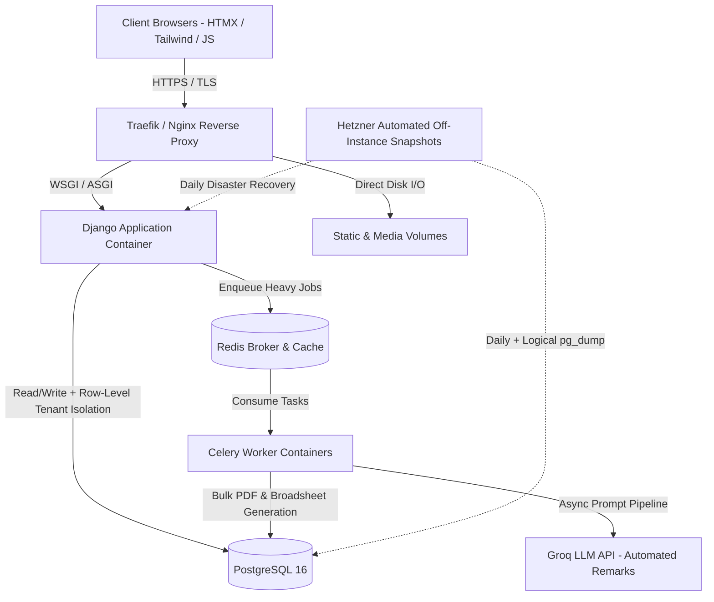

# EduSleek — Multi-Tenant SaaS Architecture & Engineering Case Study

**Live Production Platform:** [edusleek.com.ng](https://edusleek.com.ng)  
**Scale:** 1,800+ Active Users (Administrators, Teachers, Staff & Students)  
**Role:** Lead Backend & Full-Stack Engineer (Architecture, Backend, Database, DevOps)  
**Core Stack:** Python, Django, PostgreSQL, Celery, Redis, HTMX, Tailwind CSS, Docker, Coolify, Hetzner Cloud, Groq LLM API

> **Note on Source Code:** Because EduSleek is a live, commercial multi-tenant SaaS product in active production, the core repository remains private. This public repository documents the system architecture, database modeling strategies, infrastructure design, and sanitized reference patterns powering the platform.

---

## 1. System Architecture Overview

EduSleek is engineered to run reliably on cost-effective Linux VPS infrastructure while handling spiky, high-concurrency workloads (such as simultaneous Computer-Based Testing sessions and end-of-term bulk report card generation across multiple schools).

