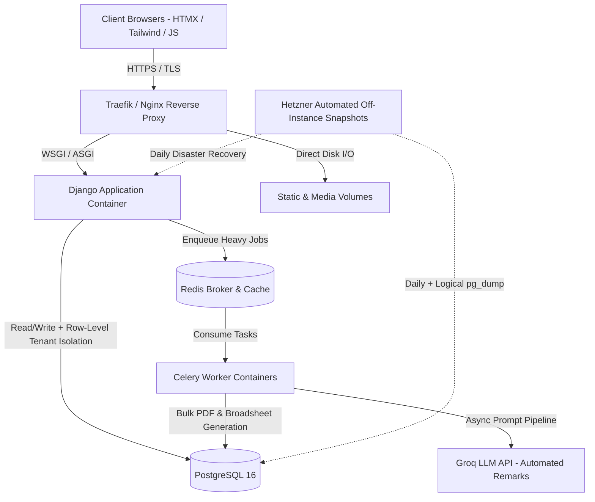

# EduSleek — Multi-Tenant SaaS Architecture & Engineering Case Study

**Live Production Platform:** [edusleek.com.ng](https://edusleek.com.ng)  
**Scale:** 1,800+ Active Users (Administrators, Teachers, Staff & Students)  
**Role:** Lead Backend & Full-Stack Engineer (Architecture, Backend, Database, DevOps)  
**Core Stack:** Python, Django, PostgreSQL, Celery, Redis, HTMX, Tailwind CSS, Docker, Coolify, Hetzner Cloud, Groq LLM API

> **Note on Source Code:** Because EduSleek is a live, commercial multi-tenant SaaS product in active production, the core repository remains private. This public repository documents the system architecture, database modeling strategies, infrastructure design, and sanitized reference patterns powering the platform.

---

## 1. System Architecture Overview

EduSleek is engineered to run reliably on cost-effective Linux VPS infrastructure while handling spiky, high-concurrency workloads (such as simultaneous Computer-Based Testing sessions and end-of-term bulk report card generation across multiple schools).

## 2. Key Engineering Challenges & Solutions
A. Dynamic Per-Tenant Grading Blueprints (Eliminating Schema Migrations)
The Problem: Every school in Nigeria operates a slightly different continuous assessment (CA) structure (e.g., School A uses CA1 (10%) + CA2 (10%) + Project (10%) + Exam (70%), while School B uses four CAs and different grade boundaries). Hardcoding columns in PostgreSQL would require custom code changes and database migrations every time a new school onboarded.

The Solution: Engineered a JSONB-backed assessment blueprint engine in PostgreSQL and Django. Each tenant school defines its grading rubric dynamically in a validated JSON schema. During result compilation, the calculation engine validates raw scores against the tenant's blueprint and computes weighted totals, grade letters, and class rankings on the fly.

B. Eliminating 502 Timeouts During End-of-Term Traffic Spikes
The Problem: Generating compiled broadsheets, PDF report cards, and bulk CSV student uploads for hundreds of students synchronously inside an HTTP request cycle blocked Gunicorn workers and triggered 502 Bad Gateway timeouts.

The Solution: Offloaded all compute-heavy and I/O-bound workloads (bulk user provisioning, termly result compilation, and AI remark generation) to Celery background workers backed by Redis. The frontend polls task progress asynchronously via lightweight HTMX endpoints, keeping web worker response times under 150ms.

C. Double-Entry Financial Ledger & Audit Trail
The Problem: School bursars require partial fee installment tracking, automated termly debt/credit carry-overs, and strict accountability against unauthorized record tampering.

The Solution: Built an atomic financial reconciliation engine (transaction.atomic()) with immutable transaction records, automated PDF receipt generation, and role-restricted audit logging.

D. Context-Aware AI Report Remarks via Groq LLM API
The Problem: Teachers spend days at the end of each term handwriting repetitive report-card comments for hundreds of students.

The Solution: Integrated the Groq API inside an asynchronous Celery pipeline that analyzes a student's structured subject scores, attendance, and grade trends to generate personalized, constructive teacher and principal remarks in seconds.

## 3. Infrastructure, DevOps & Disaster Recovery
Containerization & Orchestration: Fully containerized using Docker and deployed on Hetzner Cloud Linux VPS orchestrated via Coolify with zero-downtime rolling updates.

Two-Layer Disaster Recovery:

Infrastructure Layer: Automated off-instance Hetzner VM snapshots with a rolling 7-slot retention policy for rapid bare-metal recovery (<10 minutes RTO).

Database Layer: Scheduled logical pg_dump backups for granular, tenant-specific point-in-time table recovery without rolling back the entire multi-tenant server.

## 4. Sanitized Reference Code Included in This Repository
reference_patterns/json_grading_engine.py — Reference implementation showing how tenant-specific JSON assessment blueprints are validated and calculated in Python/Django.

reference_patterns/async_report_tasks.py — Reference implementation of fault-tolerant Celery background tasks with exponential backoff and Groq LLM integration.

docker-compose.reference.yml — Sanitized production multi-container topology (Django/Gunicorn, PostgreSQL, Redis, Celery Worker).
